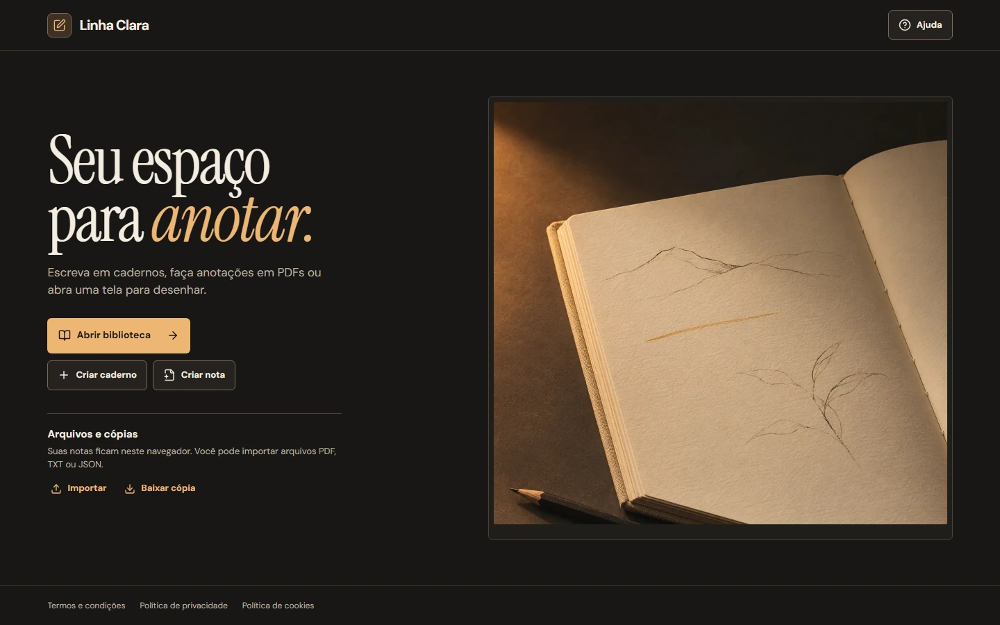
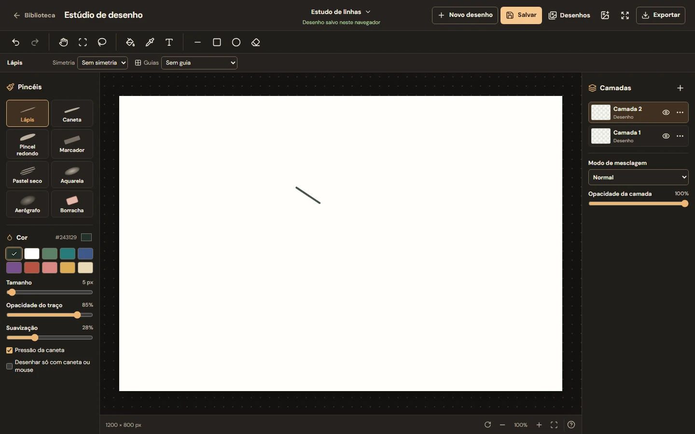

<h1 align="center">Linha Clara</h1>

<p align="center">
  Crie cadernos, anote PDFs e desenhe em camadas no navegador.
</p>

<p align="center">
  <a href="#o-que-dá-para-fazer">Recursos</a> ·
  <a href="#rode-na-sua-máquina">Instalação</a> ·
  <a href="#seus-arquivos">Armazenamento</a>
</p>



## O que dá para fazer

- **Organizar a biblioteca.** Crie cadernos, notas de texto, quadros e pastas. Encontre documentos pela busca ou pelo tipo de arquivo e alterne entre grade e lista.
- **Escrever e anotar.** Escolha papel pautado, quadriculado, pontilhado ou em branco. Escreva à mão, marque trechos de um PDF e adicione textos, figuras ou gravações de áudio aos documentos.
- **Desenhar em camadas.** Use **Novo desenho** e **Salvar** na barra do estúdio. Reabra trabalhos editáveis em **Desenhos** ou exporte em PNG, PNG transparente ou JPEG.
- **Levar uma cópia.** Importe PDF, TXT ou uma cópia JSON do Linha Clara. Exporte um documento em PDF ou baixe a biblioteca em um arquivo JSON editável.


O tema escuro destaca o papel e as ferramentas ativas. O seletor da biblioteca alterna entre **Escuro** e **Claro** e guarda a escolha. Os dois temas preservam as cores do papel e da tinta. As transições respeitam a preferência por movimento reduzido.

<details>
<summary>Veja o editor, o estúdio e a biblioteca no celular</summary>




<p align="center">
  
</p>

</details>

## Rode na sua máquina

Use **Node.js 22.13 ou superior** e npm.

```bash
git clone https://github.com/RafaelADSdev/bloco-de-notas.git
cd bloco-de-notas
npm ci
npm exec -- vite --host 127.0.0.1
```

Abra [http://127.0.0.1:5173](http://127.0.0.1:5173) e escolha **Abrir biblioteca**. A primeira visita inclui documentos de exemplo já identificados na coleção.

Para gerar e conferir a compilação de produção:

```bash
npm run build
npm exec -- vite preview --host 127.0.0.1
```

O build fica em `dist/` e inclui as entradas estáticas da biblioteca e do editor. A prévia de produção usa a porta `4173` quando disponível.

## Seus arquivos

O Linha Clara guarda a biblioteca e os desenhos no **IndexedDB** do navegador. Cada endereço e perfil tem seu próprio armazenamento. Use **Baixar cópia da biblioteca** para guardar os documentos ou transferi-los para outro navegador. Para recuperá-los, importe o JSON baixado. Exporte as imagens pelo próprio estúdio de desenho. Limpar os dados do site remove o conteúdo local.

## Como foi feito

**React e Vite** para a aplicação, **Canvas 2D** para escrita e desenho e **PDF.js e pdf-lib** para abrir e exportar PDFs. A interface usa CSS próprio e fontes hospedadas com o aplicativo.

- [Código da aplicação](src/)
- [Sistema visual](DESIGN.md)
- [Contexto do produto](PRODUCT.md)
