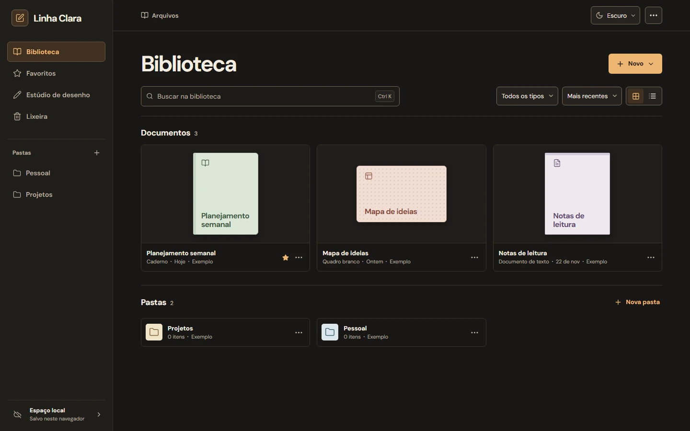
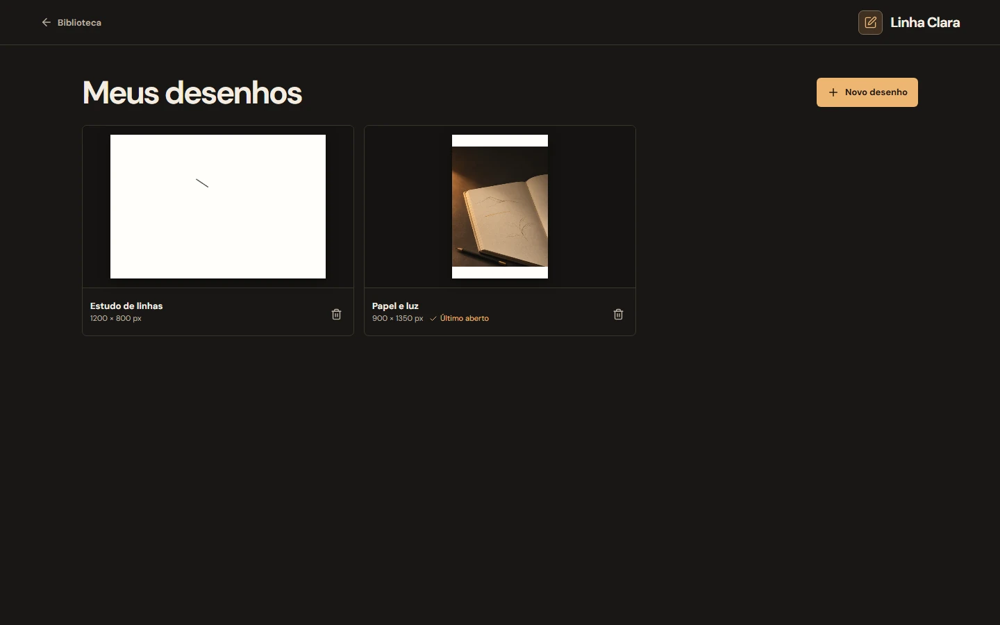
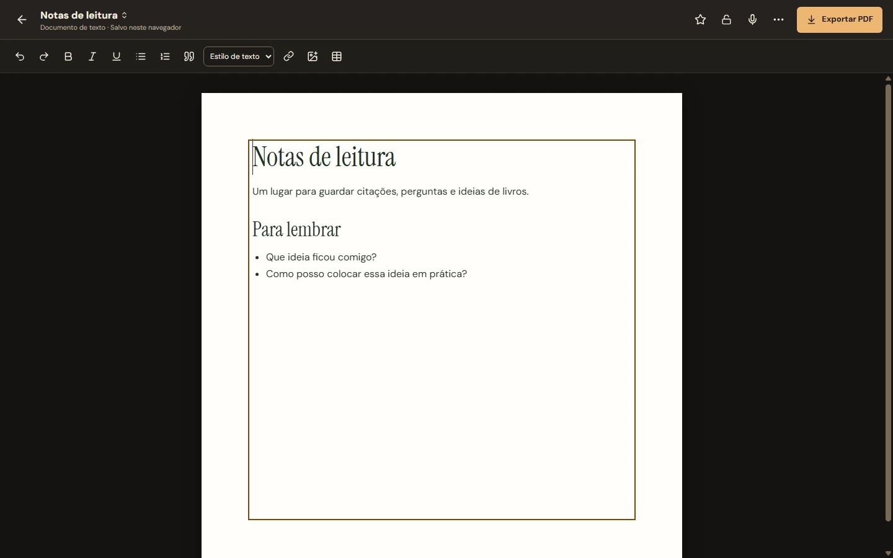
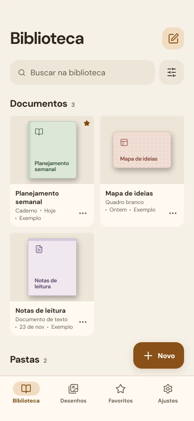
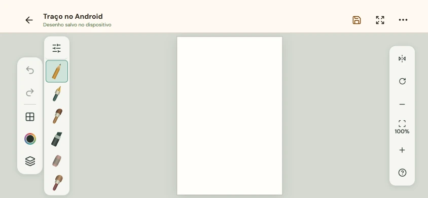

<h1 align="center">Linha Clara</h1>

<p align="center">
  Crie cadernos, anote PDFs e desenhe em camadas no navegador, no computador ou no Android.
</p>

<p align="center">
  <a href="#baixe-o-linha-clara">Downloads</a> ·
  <a href="#o-que-dá-para-fazer">Recursos</a> ·
  <a href="#rode-na-sua-máquina">Instalação</a> ·
  <a href="#seus-arquivos">Armazenamento</a>
</p>


## Baixe o Linha Clara

Abra a [prévia multiplataforma 1.0.5](https://github.com/RafaelADSdev/bloco-de-notas/releases/tag/v1.0.5-multiplataforma) e escolha um arquivo em **Assets**.

| Plataforma | Arquivo | Instalação |
| --- | --- | --- |
| Windows de 64 bits | `Linha-Clara-1.0.5-windows-x64.exe` | Execute o instalador. O EXE desta prévia é distribuído sem assinatura Authenticode. |
| macOS 13 ou posterior, Apple Silicon | `Linha-Clara-1.0.5-macos-arm64.dmg` | Abra o DMG e arraste o app para **Aplicativos**. |
| macOS 13 ou posterior, Intel | `Linha-Clara-1.0.5-macos-x86_64.dmg` | Abra o DMG e arraste o app para **Aplicativos**. |
| Android 7.0 ou posterior | `Linha-Clara-1.0.5-android.apk` | Abra o APK no aparelho e siga as instruções de instalação. |

O APK usa uma assinatura de teste. Os apps para macOS têm assinatura *ad hoc* e são distribuídos sem notarização da Apple.

## O que dá para fazer

- **Organizar a biblioteca.** Crie cadernos, notas de texto, quadros e pastas. Encontre documentos pela busca ou pelo tipo de arquivo e alterne entre grade e lista.
- **Usar no Android.** O app abre direto na biblioteca, com atalhos para Desenhos, Favoritos e Ajustes. Ao girar o celular, os controles dos editores passam para as laterais para liberar altura.
- **Escrever e anotar.** Escolha papel pautado, quadriculado, pontilhado ou em branco. Escreva à mão, marque trechos de um PDF e adicione textos, figuras ou gravações de áudio aos documentos.
- **Desenhar em camadas.** Acesse **Meus desenhos** pela biblioteca. No estúdio, escolha um pincel na barra ilustrada e abra cor, guias ou camadas quando precisar. Use carimbo, respingos, esfuminho, simetria, máscaras de recorte e timelapse.
- **Exportar um desenho.** Baixe PNG, PNG transparente, JPEG, PDF ou PSD raster em camadas pelo menu do estúdio. Use o projeto editável do Linha Clara para guardar camadas, traços e imagens e reabra a cópia em **Meus desenhos**.
- **Levar uma cópia.** Importe PDF, TXT ou uma cópia JSON do Linha Clara. Exporte um documento em PDF ou baixe a biblioteca em um arquivo JSON editável.



Os temas **Claro** e **Escuro** preservam as cores do papel e da tinta. No Android, escolha o tema e a intensidade do movimento em **Ajustes**. No navegador e no desktop, o seletor de tema e o menu **Opções do espaço** ficam na biblioteca.

<details>
<summary>Veja a galeria, os editores e a interface para Android</summary>






<p align="center">
  
</p>



</details>

## Rode na sua máquina

Use **Node.js 22.13 ou superior** e npm.

```bash
git clone https://github.com/RafaelADSdev/bloco-de-notas.git
cd bloco-de-notas
npm ci
npm exec -- vite --host 127.0.0.1
```

Abra [http://127.0.0.1:5173](http://127.0.0.1:5173) e escolha **Abrir biblioteca**. A primeira visita inclui documentos de exemplo já identificados na coleção.

Para gerar e conferir a compilação de produção:

```bash
npm run build
npm exec -- vite preview --host 127.0.0.1
```

O build fica em `dist/` e inclui as entradas estáticas da biblioteca e do editor. A prévia de produção usa a porta `4173` quando disponível.

### Gere os instaladores

- **Windows x64.** No Windows, rode `npm run package:windows`. O EXE fica em `.native-build/windows/`.
- **macOS.** Com [Zapp](https://github.com/Ironpark/zapp) disponível no PATH, rode `npm run package:macos`. O comando gera os dois DMGs em `.native-build/macos/`. Para empacotar em outro sistema, instale também o [rcodesign](https://github.com/indygreg/apple-platform-rs/releases). O sistema de arquivos precisa permitir links simbólicos para os frameworks do Electron.
- **Android.** Instale o JDK 21 e o Android SDK 36. Ajuste `JAVA_HOME` e `ANDROID_HOME`, rode `npm run build:android` na raiz e, em `android/`, execute `./gradlew :app:assembleDebug` ou `gradlew.bat :app:assembleDebug` no Windows. O APK fica em `android/app/build/outputs/apk/debug/`.

## Seus arquivos

O Linha Clara guarda a biblioteca e os desenhos localmente em **IndexedDB**. Cada perfil de navegador ou instalação tem seu próprio armazenamento. Use **Baixar cópia da biblioteca** para transferir documentos. Para recuperá-los, importe o JSON baixado. Exporte as imagens pelo próprio estúdio de desenho. No Android, as exportações abrem o seletor de arquivos do sistema. Limpar os dados do site ou do aplicativo remove o conteúdo local.

## Como foi feito

**React e Vite** para a aplicação, **Canvas 2D** para escrita e desenho e **PDF.js e pdf-lib** para abrir e exportar PDFs. A interface usa CSS próprio e fontes hospedadas com o aplicativo. **Electron** empacota o app para Windows e macOS, e **Capacitor** integra a interface móvel aos controles do Android.

- [Código da aplicação](src/)
- [Sistema visual](DESIGN.md)
- [Contexto do produto](PRODUCT.md)
- [Mapa de funções do estúdio](docs/funcoes-estudio.md)
